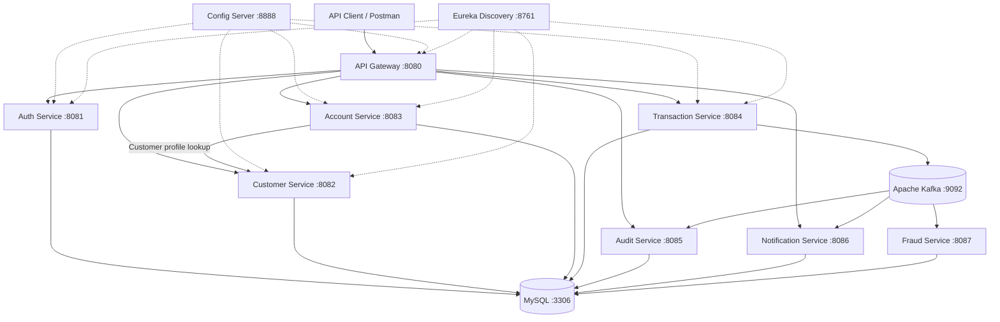

# Enterprise Banking System

**Java 21 · Spring Boot · Spring Cloud · Microservices · Apache Kafka · MySQL · Docker · Kubernetes · AWS (deployment work in progress)**

A portfolio project exploring the design and implementation of a modular, cloud-oriented banking backend. It demonstrates how independently deployable Spring Boot services can work together using REST APIs, service discovery, centralized configuration, and event-driven messaging.

> **Project status:** Active development and integration. This repository is a learning and engineering portfolio project, **not** a production banking platform. AWS EKS deployment and end-to-end validation are ongoing; do not assume every feature or environment is production-ready.

## Architecture at a glance



*Conceptual service interaction diagram; consult the source code and configuration for implemented routes, event consumers, and persistence details.*

## Technology stack

| Area | Technologies |
| --- | --- |
| Language and framework | Java 21, Spring Boot, Spring Cloud |
| APIs and security | REST, Spring Security, JWT, Bean Validation |
| Service infrastructure | Spring Cloud Gateway, Eureka, Config Server, OpenFeign |
| Messaging | Apache Kafka |
| Persistence | MySQL, Spring Data JPA / Hibernate |
| Build and development | Maven multi-module project, IntelliJ IDEA, Postman, Git |
| Containers and orchestration | Docker, Docker Compose, Kubernetes |
| Cloud | AWS / Amazon EKS (deployment work in progress) |
| Automation and monitoring | GitHub Actions workflows, Prometheus configuration |

## Modules

| Module | Default port | Responsibility |
| --- | ---: | --- |
| `discovery-server` | 8761 | Eureka service registration and discovery |
| `config-server` | 8888 | Centralized Spring configuration |
| `api-gateway` | 8080 | Entry point and routing for backend APIs |
| `auth-service` | 8081 | User registration, authentication, JWT-based access |
| `customer-service` | 8082 | Customer profile management |
| `account-service` | 8083 | Banking accounts and account retrieval |
| `transaction-service` | 8084 | Banking transaction workflows |
| `audit-service` | 8085 | Audit-event processing and persistence |
| `notification-service` | 8086 | Notification-event processing |
| `fraud-service` | 8087 | Fraud-related event processing |

## Repository layout

```text
enterprise-banking-system/
├── .github/workflows/
├── account-service/
├── api-gateway/
├── audit-service/
├── auth-service/
├── config-server/
├── customer-service/
├── discovery-server/
├── fraud-service/
├── k8s/
├── notification-service/
├── transaction-service/
├── docker-compose.yml
├── pom.xml
├── prometheus.yml
└── README.md
```

## Getting started

### Prerequisites

- JDK 21
- Maven (or a Maven installation configured in IntelliJ IDEA)
- Docker Desktop with Docker Compose
- MySQL and Kafka, either through the supplied infrastructure configuration or an equivalent local setup
- Optional: `kubectl` and a local Kubernetes cluster

### 1. Clone

```powershell
git clone https://github.com/edwardssevume/enterprise-banking-system.git
cd enterprise-banking-system
```

### 2. Review configuration and required secrets

Review each service's configuration and the files under `k8s/` before starting. The system uses environment variables such as:

```text
CONFIG_SERVER_URL
EUREKA_URL
MYSQL_HOST
MYSQL_PORT
MYSQL_USER
MYSQL_PASSWORD
AUTH_DB_URL
CUSTOMER_DB_URL
ACCOUNT_DB_URL
TRANSACTION_DB_URL
JWT_SECRET
KAFKA_BOOTSTRAP_SERVERS
INTERNAL_SERVICE_SECRET
```

Provide real values through **local environment variables or a secure secrets manager**, never in commits. The database URLs must point to existing, accessible schemas. Variable requirements can differ by service; use each service's `application.yml` and centralized configuration as the source of truth.

### 3. Start dependencies

Inspect `docker-compose.yml` to confirm which containers and settings it starts, then run:

```powershell
docker compose up -d
```

### 4. Build

```powershell
mvn clean package -DskipTests
```

For a full verification build, omit `-DskipTests` once the required dependencies and test environment are configured. This command describes the intended build workflow; successful execution depends on the current state of the modules and environment.

### 5. Run services

Start the **discovery server**, then the **config server**, followed by the gateway and business services using IntelliJ IDEA run configurations or the corresponding module JARs. Ensure each service receives the environment variables it requires.

Useful local endpoints (when the respective services are running):

| Component | URL |
| --- | --- |
| Eureka dashboard | `http://localhost:8761` |
| API Gateway | `http://localhost:8080` |
| Auth service | `http://localhost:8081` |

### 6. Explore sample API routes

These are representative routes from the project; authentication and payload requirements vary by endpoint.

| Method | Route | Purpose |
| --- | --- | --- |
| `POST` | `/api/auth/register` | Register a user |
| `GET` | `/api/customers/me` | Get authenticated customer's profile |
| `POST` | `/api/customers` | Create customer profile |
| `POST` | `/api/accounts` | Open an account |
| `GET` | `/api/accounts/me` | List authenticated customer's accounts |

Example request through the gateway (adjust to the current DTO and security configuration):

```powershell
curl.exe -X POST http://localhost:8080/api/auth/register `
  -H "Content-Type: application/json" `
  -d '{"username":"demo_user","email":"demo@example.com","password":"replace-with-a-strong-demo-password"}'
```

> For authenticated routes, supply a valid `Authorization: Bearer <token>` header. Never publish real tokens or passwords in screenshots or documentation.

## Kubernetes and AWS

The `k8s/` directory contains Kubernetes deployment resources for the `enterprise-bank` namespace. Local Kubernetes configuration has been part of the project's development workflow. AWS EKS and load-balancer-controller setup are **ongoing**; a completed public cloud deployment is not claimed here.

To inspect manifests before applying them:

```powershell
kubectl get namespaces
kubectl get pods -n enterprise-bank
kubectl get services -n enterprise-bank
```

Review and secure Kubernetes Secrets before applying manifests. Do not commit plaintext credentials or sensitive values.

## Security and engineering considerations

- JWT-based authentication and role-aware authorization are part of the backend design.
- Credentials, signing secrets, and internal service secrets must be supplied securely and kept out of version control.
- Use distinct least-privilege database users in real deployments; local root credentials are not a production recommendation.
- Banking transaction correctness requires careful validation, authorization, concurrency controls, and auditable processing.
- This is an educational portfolio system: do not use it to process real customer or financial data.

## Roadmap

- [ ] Validate end-to-end authentication, customer, account, and transaction workflows
- [ ] Expand automated unit, integration, and messaging tests
- [ ] Complete and verify AWS EKS deployment
- [ ] Add architecture and deployment screenshots
- [ ] Document observability, resilience, and operational runbooks
- [ ] Review secrets and historical commits before public promotion

## Author

**Edward Ssevume**  
[LinkedIn](https://www.linkedin.com/in/edward-ssevume-8a63abb1) · [GitHub](https://github.com/edwardssevume)

---

*Portfolio demonstration of Java backend development, Spring Boot microservices, distributed architecture, and cloud-native engineering practices.*
